## What you'll learn today {.smaller}

::: {.columns}
::: {.column width="48%"}
<div class="track">
<div class="track-head">📊 Data-science foundations</div>

- Causality — prediction vs. *effect*
- Interrupted time series
- Bayesian uncertainty
</div>
:::
::: {.column width="48%"}
<div class="track">
<div class="track-head">🤖 Agent foundations</div>

- MCP — connect your agent
- Iterative loops — build trust
- Verification — don't self-grade
- Skills — codify the workflow
</div>
:::
:::

<p class="tagline">Two tracks, woven through **one case study**: a real price hike.</p>

::: {.notes}
The two tracks of the session, run in parallel and applied to a single price-hike case study throughout. Data-science foundations: why causal (not just predictive), and how to put uncertainty on the answer. Agent foundations: the toolkit — MCP, the iterative build-trust loop, skills, verification. Each foundation is immediately applied in a case-study segment (mostly live in the notebook). "Foundation → case study", repeated.
:::

# Agent Foundations: MCP {.section-divider}

<p class="kicker">Connect your agent to the world</p>

## Let's pick up where we left off {.live-slide}

<span class="live-demo">Live</span>

> “Recap last week's session — and build me a quick interactive notebook.”

<p class="tagline">The agent pulls the recap, then **builds it live** while you watch.</p>

::: {.notes}
The opener IS a demo — "show, then tell." In Claude Code: ask it to review last session (it reaches Daimon for the Notion/Discord recap) and to spin up a marimo notebook via marimo pair, building a small anywidget as it goes. Fast, real, something happens on screen in the first few minutes. Then: "what I just did already leaned hard on MCP." Now we establish it.
:::

## That was MCP {.smaller}

<p class="tagline">MCP is the **connection**. Skills are the **instructions**.</p>

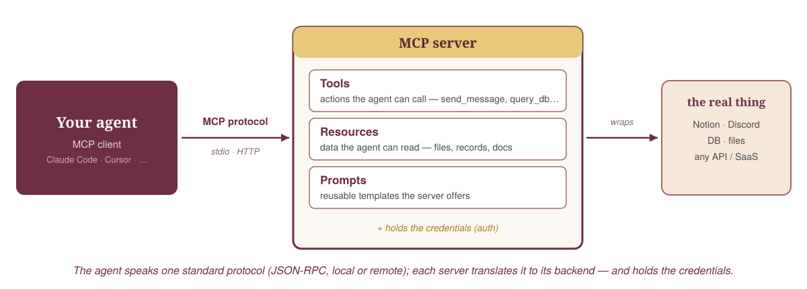{width="80%" fig-align="center"}

::: {.notes}
The reveal + mental model. Said out loud (not on the slide): the decision rule — (1) can the agent already do it with a CLI it writes itself? do that; (2) needs auth, one-line sharing, or server-side logic? MCP; (3) never preload all tool definitions (Anthropic: 150K→2K tokens). And kill the myth: "Skills vs MCP" is a false fight — orthogonal. Use both.
:::

## MCP — three use cases {.smaller}

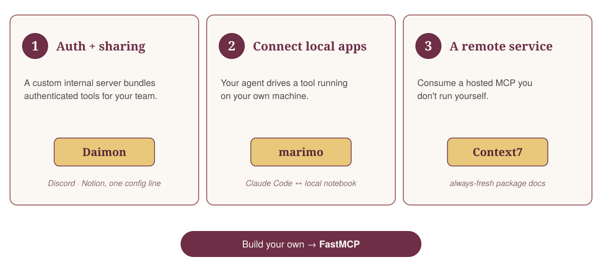{width="92%" fig-align="center"}

::: {.notes}
Structure the whole MCP section around these three — "I use MCP for X." (1) Auth + sharing: a custom internal server (Daimon) bundles authenticated tools for the team. (2) Connect local apps: your agent drives a tool on your machine — Claude Code ↔ marimo's local MCP server. (3) A remote service: consume a hosted MCP you don't run — Context7. And to build your own, FastMCP is the best path. The opener already demoed (1) and (2) live.
:::

## {.smaller}

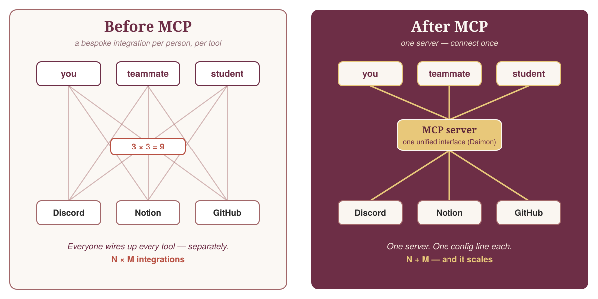{width="88%" fig-align="center"}

::: {.notes}
Zoom on use case 1 (auth + sharing). Before: every person wires up every tool — N×M bespoke integrations. After: each agent speaks MCP once to one server (Daimon) — N+M, and a new teammate joins with one config line: `/mcp-connect` in Discord. That's why distribution to a cohort is one line, not 20 setups.
:::

## Context7 {.smaller}

<p class="tagline">Fresh, version-correct docs for any library — injected on demand.</p>

::: {.notes}
Use case 3, made concrete: a hosted MCP you just consume. One config line, read-only, free; it un-freezes the model's library knowledge (frozen at training cutoff). CausalPy and PyMC already indexed, re-crawled weekly. The boundary, and the bridge to skills: Context7 gives docs, not judgment — your opinionated workflow lives in a skill.
:::

## You can already do this {.smaller}

<div class="pillar-grid">
<div class="pillar"><div class="icon">🔌</div><div class="name">Daimon MCP</div><div class="desc"><code>/mcp-connect</code> in Discord</div></div>
<div class="pillar"><div class="icon">🎛️</div><div class="name">marimo pair</div><div class="desc">pair in one live notebook</div></div>
<div class="pillar"><div class="icon">📚</div><div class="name">Context7</div><div class="desc">fresh docs, one line</div></div>
<div class="pillar"><div class="icon">📑</div><div class="name">Skills</div><div class="desc">the <em>how</em> (from Hugo)</div></div>
</div>

::: {.notes}
The "they leave with it" payoff, then bridge: that's the first agent foundation — now the data-science foundation (why we need causal thinking).
:::

# Data Science Foundations: Causality {.section-divider}

<p class="kicker">Why prediction isn't enough</p>

## Data science was always about decisions {.smaller}

<p class="tagline">The point was never “build models.” It was: **make better decisions.**</p>

::: {.notes}
A decade of the job was plumbing. The luxury we never had: time to think causally about the data-generating process. Agents do the plumbing now — so we finally get to do the part DS was *for*.
:::

## Prediction vs. causal {.smaller}

<p class="tagline">Ice-cream sales **predict** drownings. Banning ice cream **saves no one.**</p>

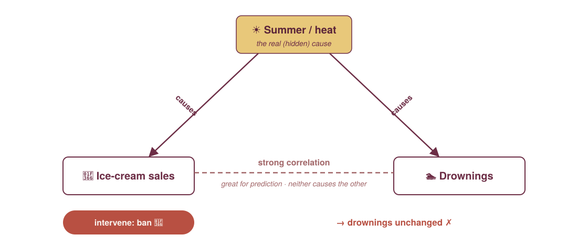{width="72%" fig-align="center"}

<p class="footer-note">Correlation is enough to <strong>predict</strong>; the moment you <strong>act</strong>, you need the cause. Hugo's EDA said: change the price. We did — <strong>what did it cost us?</strong></p>

::: {.notes}
The classic spurious correlation: ice-cream sales and drownings both spike in summer, so each predicts the other beautifully. But banning ice cream changes nothing; heat is the common cause. Prediction rides correlation; intervention needs the causal structure. That's why "did the price hike cause the drop?" is not something a predictive model can answer — and it's exactly today's question.
:::

## Why causality *now* {.smaller}

<p class="tagline">Agents and causal models need each other.</p>

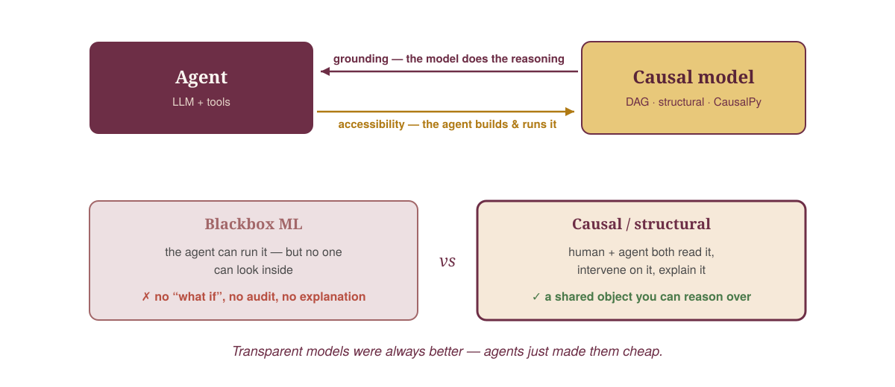{width="86%" fig-align="center"}

::: {.notes}
The thesis. Lead with transparency: an agent's leverage is bounded by what you AND it can reason about. A blackbox ML model is opaque to both — you can call it, not interrogate it — so handing an agent a blackbox just moves the opacity around. A causal/structural model is the opposite: it *is* the reasoning — an explicit, inspectable claim both human and agent can read, intervene on, explain. Two directions: agents need causal models for **grounding** (causal/probabilistic reasoning is where LLMs are least reliable — the structure carries it); causal models need agents for **accessibility** (the friction that kept Bayesian/causal niche collapses when the agent builds and drives it). Why *now*: transparent models were always right but too costly — agents remove that cost, so the right thing is finally the cheap thing.
:::

## Causality is a whole landscape {.smaller}

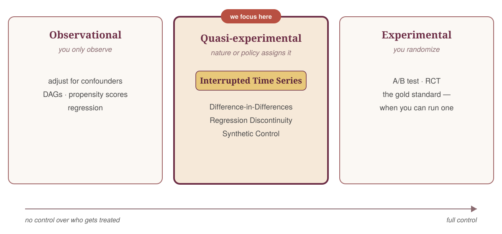{width="88%" fig-align="center"}

::: {.notes}
Don't jump straight to ITS — orient first. How was the treatment assigned? Observational (adjust for confounders), quasi-experimental (nature/policy assigns it → ITS, DiD, RDD, synthetic control), experimental (you randomize → A/B test, gold standard when feasible). We had no A/B test, only a price change at a known date — so quasi-experimental, and ITS is the natural tool.
:::

## What is interrupted time series? {.smaller}

<p class="tagline">Model the world *without* the intervention. The gap is the effect.</p>

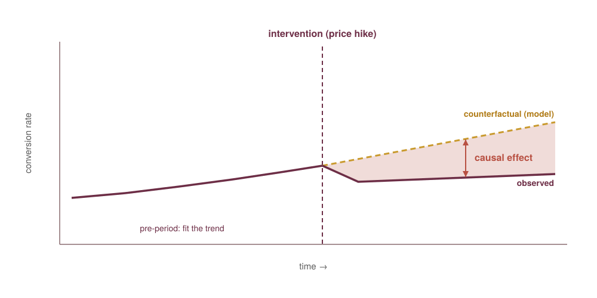{width="60%" fig-align="center"}

::: {.notes}
Fit the pre-intervention trend, extrapolate it past the intervention (the counterfactual), compare to what actually happened. The gap is the causal effect. Two assumptions: the trend would have continued, and nothing else changed at the same moment — exactly what the diagnostics check.
:::

## CausalPy — the tool {.smaller}

<p class="tagline">Quasi-experiments as one-liners: **encode the design, get the counterfactual.**</p>

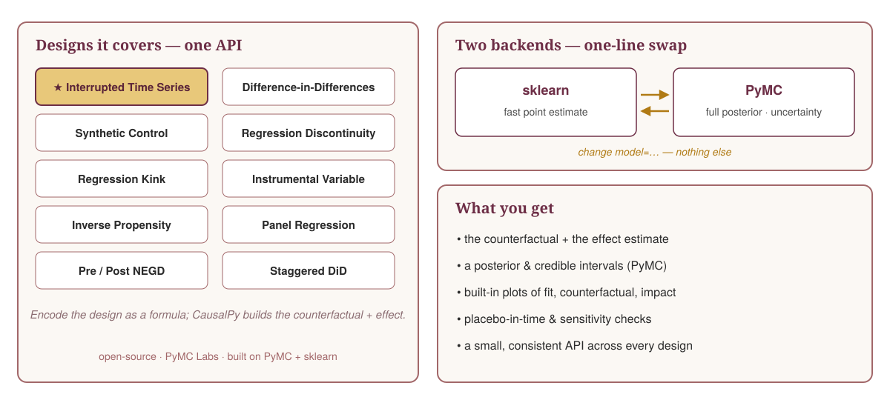{width="93%" fig-align="center"}

::: {.notes}
CausalPy is PyMC Labs' open-source library for quasi-experimental causal inference (built on PyMC + sklearn). One small, consistent API across designs — ITS, DiD, synthetic control, RDD, IV, … — encode the design as a formula and it builds the counterfactual + effect. Two backends: sklearn (fast point estimate) ↔ PyMC (full posterior), a one-line `model=` swap. Plus built-in plots and placebo/sensitivity checks. The `causalpy-library` skill wraps its idioms.
:::

# Agent Foundations: Iteratively building trust & automation {.section-divider}

<p class="kicker">Small loops → earned autonomy</p>

## Levels of automation — like self-driving {.smaller}

<p class="tagline">Autonomy is how much you **hand over** — not what the model can do. Today: **L1 → L3**.</p>

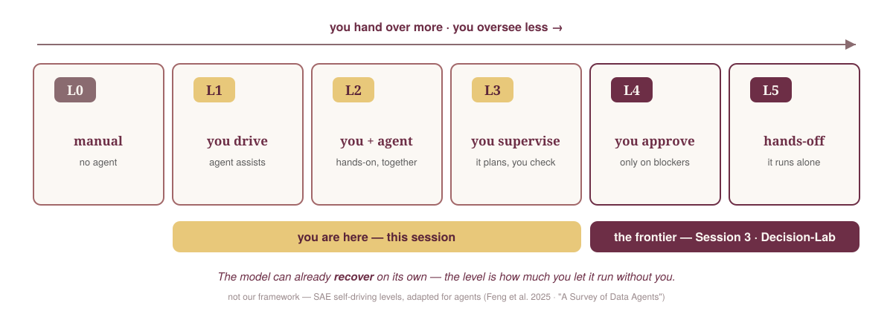{width="94%" fig-align="center"}

<p class="footer-note">Borrowed, not ours: the SAE self-driving levels, adapted for agents (Feng et al. 2025; <em>A Survey of Data Agents</em>). Claude Code can already <em>recover</em> on its own — we still <em>choose</em> to supervise (L2–L3) because a confidently-wrong causal answer is expensive. L4–L5 is for later sessions.</p>

::: {.notes}
Frame this as OVERSIGHT, not model capability — and flag it's an external framework (SAE self-driving, adapted by Feng et al. 2025 and the Data-Agents survey), i.e. independent validation of the "trust dial" idea. The levels are the human's role: L0 manual; L1 you drive (agent assists on ask); L2 you + agent, hands-on; L3 you supervise (it plans, you check); L4 you approve (it runs, asks only on blockers); L5 hands-off. Handle the obvious objection out loud: "isn't Claude Code already L4 — it recovers from its own errors?" Recovery is a *capability* the model has; the *level* is how much oversight you keep, which is a risk/trust choice. For a consequential causal answer we deliberately stay L1–L3 even though it could run more autonomously. The two loops next are *how* you earn rungs: skills + verification.
:::

## Iteratively building data-science agents {.smaller}

<p class="tagline">Start with the human close. Hand over as trust is earned.</p>

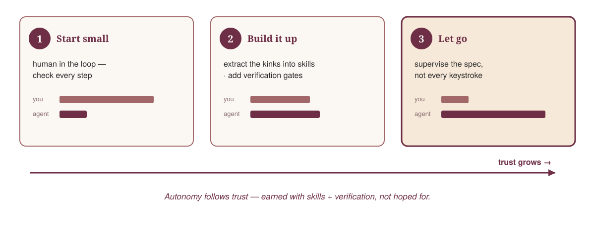{width="92%" fig-align="center"}

::: {.notes}
The agentic-workflow principle. You don't hand over the keys on day one. Start with small loops, human-in-the-loop on every step. As you extract the recurring kinks into skills and add verification gates, you trust the agent more and step back — supervising the spec, not every keystroke. Autonomy follows trust; earned with skills + verification, not hoped for. (Luca pushes this further in Session 3 with the auto-loop.)
:::

## Make the loop robust: log → skill {.smaller}

<p class="tagline">Every run leaves a trail — distil it into the skill.</p>

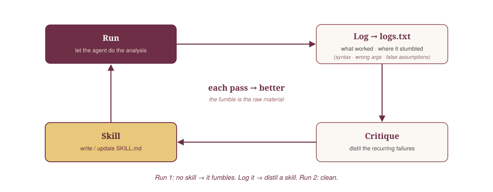{width="86%" fig-align="center"}

::: {.notes}
How you actually get the skill. Run 1: no skill, just go — the agent fumbles. We log everything to logs.txt: what worked, where it stumbled. A critical pass over the log distils the recurring failures into a SKILL.md. Run 2 is cleaner; log again, sharpen again. Each iteration the skill improves and the loop gets more robust. The fumble isn't a failure — it's the raw material for the skill. We'll do exactly this across the next two case-study segments.
:::

# Case Study 1: CausalPy without skills {.section-divider}

<p class="kicker">The first run — watch it reason itself into a trap</p>

## The setup {.smaller}

<p class="tagline">Prices up ~33% on one day. No A/B test. **How much did it cost us?**</p>

- Only the time series → interrupted time series.

::: {.notes}
Freemium subscriptions; prices rose ~33% on a single date; leadership wants the cost. No A/B test — only the time series. The drop is visible but small next to day-to-day noise. We drive the whole thing through the agent. (True simulated answer: elasticity −0.6; honest target is a small negative effect.)
:::

## First CausalPy attempt — no skill {.live-slide}

<span class="live-demo">Live · correct sign, wrong model, unchecked story</span>

```python
cp.InterruptedTimeSeries(
    df_2024_07_on, treatment_time,
    formula="conv_rate ~ 1 + t + C(dow)",
)
```

<p class="tagline">Correct negative effect, wrong model — then a compelling unchecked story turns it into “no effect.”</p>

- Wrong model: `C(dow)` by habit; missing annual Fourier seasonality.
- Correct sign: roughly −16%.
- Typical LLM failure mode: a confident, plausible, **wrong** answer.

::: {.notes}
Run `notebooks/01-blind-run-without-skill.py` / the blind run. The actual no-skill run does not identify the annual Fourier basis. It starts too simple, then trims the noisy early period and adds a day-of-week term by habit. So this is a useful teaching case: the model is wrong, but it still finds the correct negative direction. Then the analyst invents a compelling causal-sounding mechanism — the pool of users who can still subscribe changes over time, March spike, denominator drift — and turns the result into "little or no real effect" before running validation. That is a typical LLM failure mode: fluent unchecked explanation, not lack of code execution. The log is still useful, but we do not distil the skill from the run's own self-assessment.
:::

## The trap: subscriber-pool drift {.smaller}

<p class="tagline">Flat conversions ÷ growing subscriber pool ⇒ a smooth rate decline.</p>

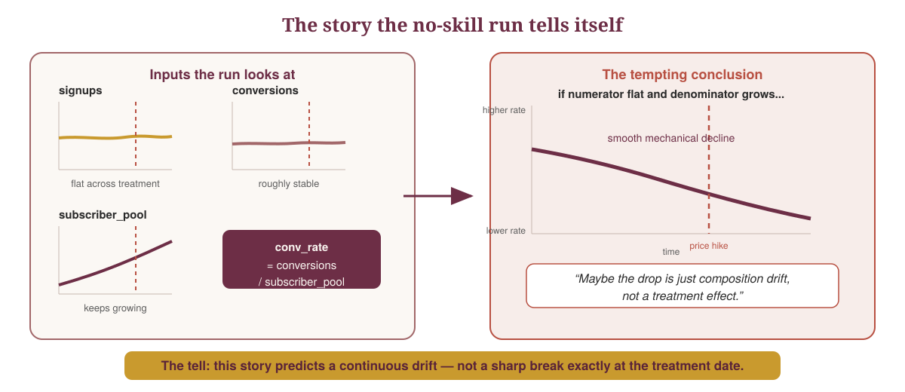{width="92%" fig-align="center"}

<p class="footer-note"><code>subscriber_pool</code> means users who could still become subscribers. The tell: pool drift is continuous; a treatment effect is a break.</p>

::: {.notes}
Explain this slowly, because this is where people get lost. `subscriber_pool` means users who could still become subscribers today. New signups enter that pool; users who subscribe leave it. The blind run reasoned: signups are flat, so the intervention probably did not change inflow. The subscriber pool keeps growing while conversions stay roughly flat. Since `conv_rate = conversions / subscriber_pool`, maybe the rate falls mechanically because the remaining non-subscriber pool is harder to convert. Therefore the pre-period trend might be subscriber-pool drift, not a structural relationship safe to project.

Then quote the conclusion: "The pre/post drop is largely a composition artifact of the remaining non-subscriber pool, not a treatment effect. The intervention had little or no real effect. I would not ship a negative number."

Now the tell: that story predicts a smooth rate decline, because the pool changes continuously. A smooth drift is exactly what the ITS trend is supposed to absorb. It only kills the causal claim if it creates a fake break at the treatment date. That is why the validator asks two things: first, does the mechanism even have the right sign? Here no — the pre-period subscription rate rises as the pool grows. Second, if subscriber-pool drift is manufacturing the effect, do fake pre-period treatment dates also show effects? Here no — the placebos are near zero.

Also mention the late-March bump separately: that is anticipation. People subscribe before the announced price hike to lock in the old price. That can contaminate the baseline and exaggerate the estimated drop a bit, so the skill-guided run guards out the last 7 pre-treatment days. But it is not a reason for "no effect"; removing March still leaves a negative effect.
:::

# Agent Foundations: Verification {.section-divider}

<p class="kicker">Don't let the agent grade itself</p>

## Plausible ≠ correct {.smaller .live-slide}

<span class="live-demo">Live</span>

<p class="tagline">The most dangerous wrong answer is the one with a good story.</p>

- Wrong story: easy subscribers already left → mechanical conversion-rate drop.
- Data check: the pre-period rate is **rising**, not decaying.
- Placebo check: fake dates center near zero; the real date stands out.

::: {.notes}
The blind run's argument sounds sophisticated: the pool of users who can still subscribe keeps changing, so maybe the drop is mechanical. The validator catches the sign error: over the pre-period, the subscription rate rises as the pool grows. Then the placebo-in-time sweep shows the model is not manufacturing negative effects before treatment. This is the self-review lesson: the original context is contaminated by its own persuasive story.
:::

## Placebo-in-time {.smaller}

<p class="tagline">Move the treatment to dates where **nothing happened**. The effect should disappear.</p>

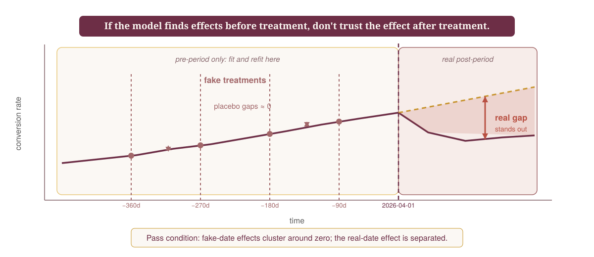{width="90%" fig-align="center"}

<p class="footer-note">Notebook version: refit the same ITS at fake pre-period dates (−90, −180, −270, −360 days). Placebo effects near zero mean the counterfactual is not manufacturing the real drop.</p>

::: {.notes}
This is the data-science foundation inside the verification block. A fitted ITS always returns a number, so we ask whether the method finds effects when there was no intervention. In the notebook we keep only the real pre-period, plant fake treatment dates 90/180/270/360 days before April 1, 2026, refit the same formula, and measure the fake post-period gap. If those placebos are near zero while the real effect is negative and separated, the model is not just fitting trend or seasonality noise. This is a formal refutation test, not an agent opinion.
:::

## Validate with a fresh reviewer {.smaller .live-slide}

<span class="live-demo">Live · the `causal-critiquer` skill</span>

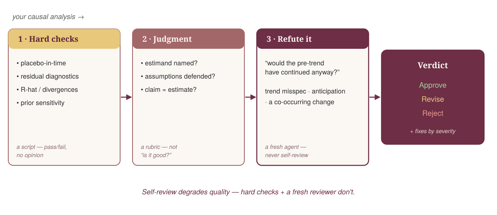{width="80%" fig-align="center"}

<p class="footer-note">The <code>causal-critiquer</code> skill runs as a <strong>fresh sub-agent</strong> over the hard-check results — no stake in the analysis, so it isn't grading its own work. Why fresh: LLMs that self-correct without an external signal tend to get <em>worse</em> — <a href="https://arxiv.org/abs/2310.01798">Huang et al., <em>LLMs Cannot Self-Correct Reasoning Yet</em>, ICLR 2024 (arXiv:2310.01798)</a>.</p>

::: {.notes}
Three layers: (1) a script runs hard checks — placebo-in-time, MCMC diagnostics when available, prior sensitivity when available; (2) a rubric pass — estimand named? assumptions hold? claim = estimate?; (3) a fresh-context sub-agent tries to refute the result. In this case it overturns the bottom line: the composition story is false, the real date is an outlier, and the corrected conclusion is a robust negative effect of roughly −12% to −18%. The validator also treats the late-March spike correctly: as anticipation / pre-treatment contamination to guard against, not as evidence for "no effect."
:::

## Anatomy of the skill {.smaller}

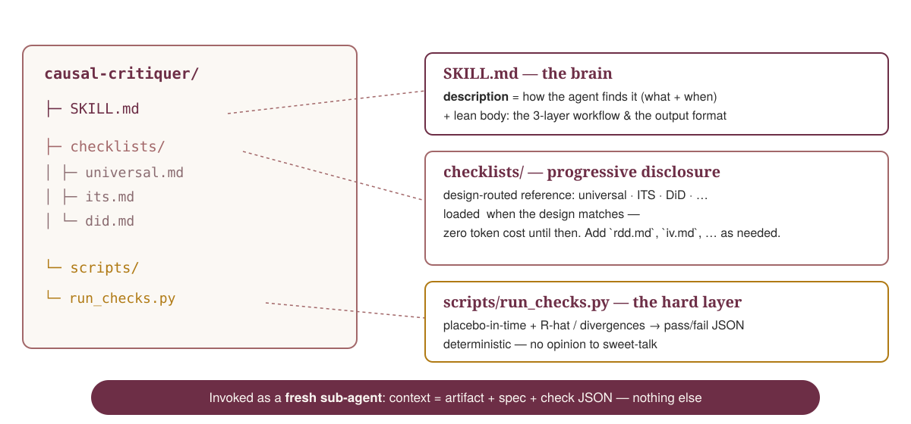{width="92%" fig-align="center"}

::: {.notes}
What a good skill looks like inside — the validator from the last slide. (1) **SKILL.md** — the `description` is how the agent picks it (what + when); lean body = the 3-layer workflow + output format. (2) **checklists/** — progressive disclosure: design-specific reference (universal / ITS / DiD) loaded only when the design matches. (3) **scripts/run_checks.py** — the deterministic hard-check layer emitting pass/fail JSON the LLM can't talk around. Invoked as a fresh sub-agent. The template students copy.
:::

# Case Study: Verification {.section-divider}

<p class="kicker">live in the notebook</p>

::: {.notes}
NB only: run `causal-critiquer` on the blind case-study analysis — the deterministic placebo-in-time check + the fresh-context refutation pass — and read the structured verdict. It catches the backwards composition-drift mechanism and the missing placebo sweep. The cue, then live.
:::

# Agent Foundations: Skills {.section-divider}

<p class="kicker">Codify the validated workflow</p>

## A skill is onboarding docs {.smaller}

<p class="tagline">…for a brilliant new colleague with **amnesia between tasks**.</p>

- Description is everything — *what* + *when*.
- Progressive disclosure — README, not the manual.
- Concrete idioms > prose.

::: {.notes}
Now we can talk about skills with the right causal order. Don't distil the first run's persuasive wrong explanation into a skill. Distil the validated workflow: what the run tried, what the reviewer caught, and which hard checks are now mandatory. You're not teaching Claude Python — it's an expert. You hand it your house rules. The description is the whole ballgame; concrete idioms beat prose.
:::

## Skills rescue weaker models — on the hard tasks {.smaller}

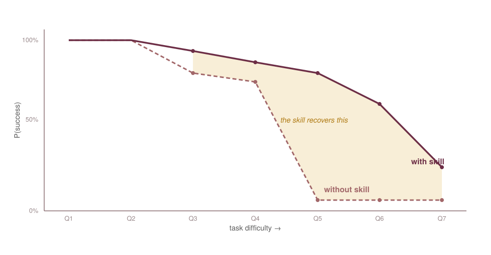{width="70%" fig-align="center"}

<p class="footer-note">Without the skill, success falls off a cliff as tasks get harder; with it, the agent holds and stretches the ceiling — especially on the hard tasks.</p>

::: {.notes}
SkillBench (PyMC Labs / Carlos Trujillo). This plot is the pymc-marketing result — a *different* skill — shown for the general message: skills make the agent more reliable, especially on hard tasks, so you can use cheaper models. CausalPy: success collapses 84%→12% by difficulty; a good (dense) skill cuts the hand-rolling anti-pattern from ~7.5% to 3.3%, a prose-only one doubles it to 18.3% — why concrete idioms > prose. ⚠️ WIP — clear with Carlos before external use; redrawn figure is illustrative.
:::

## …and they save tokens {.smaller}

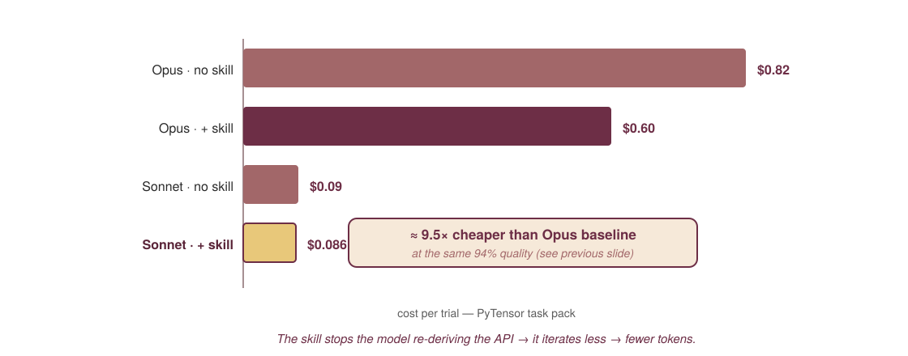{width="78%" fig-align="center"}

<p class="footer-note">A cheap model + the skill matches the expensive model's quality at <strong>~9.5× lower cost</strong> — because it stops re-deriving the API and just writes the canonical call.</p>

::: {.notes}
The economics half of SkillBench. The skill doesn't only lift accuracy — it changes cost. The model iterates less (fewer retries, less rambling), exchanging input tokens for output tokens. Sonnet+skill ≈ $0.086/trial vs Opus baseline $0.82 at matched 94% quality — ~9.5× cheaper. So a skill lets a cheaper model do the expensive model's job. ⚠️ Carlos's WIP numbers; figure to be exported.
:::

# Case Study 2: Re-running with our skills {.section-divider}

<p class="kicker">live in the notebook</p>

::: {.notes}
NB only: re-run the same ITS with the quasi-experiment skill loaded. The skill forces the right discipline: name the estimand, decompose the subscription rate into new subscriptions and users still able to subscribe, model the counterfactual, run a placebo before accepting or rejecting the effect. Show `notebooks/03-skill-guided-analysis.py` as the "same data, different workflow" pass.
:::

# Data Science Foundations: Bayesian Uncertainty {.section-divider}

<p class="kicker">How sure are we?</p>

## {.smaller}

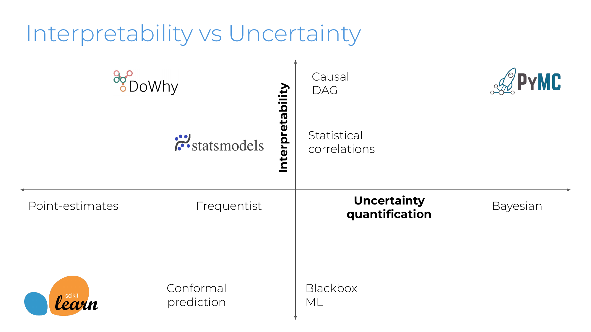{width="80%" fig-align="center"}

::: {.notes}
From my Bayesian Causal Inference talk — the landscape. Two axes: interpretability (do you understand the model?) and uncertainty (a point estimate vs a full distribution). scikit-learn: strong predictions, low interpretability, point estimates. statsmodels / DoWhy: interpretable but frequentist. PyMC sits top-right — a causal/structural model *and* full Bayesian uncertainty. That corner is what you want for decisions.
:::

## From a point estimate to a distribution {.smaller}

<p class="tagline">Causality tells you *what* happens. Bayes tells you *how sure* you are.</p>

- Our ITS fit one best line — point estimates, no error bars.
- Bayes: same model, priors → **posteriors** = distributions.

::: {.notes}
The ITS we ran fit the sin/cos + linear-trend model by optimization → single best-fit parameters, a point estimate. Bayes keeps the exact same structure but treats each parameter as a distribution: prior in, posterior out. Instead of "the effect was −X" you get the full distribution of plausible effects — and the width is the risk.
:::

## In CausalPy, it's one line {.smaller}

<span class="live-demo">Live</span>

```python
# what we ran — a point estimate
cp.InterruptedTimeSeries(df, t, formula, model=LinearRegression())

# same model, now Bayesian — uncertainty for free
cp.InterruptedTimeSeries(df, t, formula, model=cp.pymc_models.LinearRegression())
```

<p class="tagline">You don't write MCMC. Swap the backend; the agent does the rest.</p>

::: {.notes}
The agentic payoff: we don't hand-write a sampler. Tell the agent "make it Bayesian," it swaps the CausalPy backend to a PyMC model, and we get posteriors. The skill + Context7 keep the API right. Under the hood it's PyMC; from our seat it's one line. The lesson is agentic leverage, not a Bayes lecture.
:::

# Case Study: Bayesian Uncertainty {.section-divider}

<p class="kicker">live in the notebook</p>

## Now we can answer probabilistically {.smaller}

<p class="tagline">The effect is not the decision. Carry uncertainty into the business quantity.</p>

::: {.columns}
::: {.column width="48%"}
<div class="track">
<div class="track-head">Metric</div>

- Subscriptions go down.
- Posterior: effect < 0.
- Causal answer: the hike reduced conversion.
</div>
:::
::: {.column width="48%"}
<div class="track">
<div class="track-head">Decision</div>

- Price goes up more than volume falls.
- Revenue can still rise.
- Decision answer: evaluate money, not only conversion.
</div>
:::
:::

::: {.notes}
Use `notebooks/04-bayesian-decision-analysis.py`. Same analysis with the PyMC backend: the treatment effect is a posterior distribution, not a single number. Then propagate that distribution into revenue: fewer subscriptions, each worth more. The point is not "Bayes because Bayes"; it is carrying uncertainty to the quantity the decision actually uses.
:::

# Wrap {.section-divider}

## What you leave with {.smaller}

::: {.columns}
::: {.column width="48%"}
<div class="track">
<div class="track-head">📊 Data science</div>

- causal thinking + ITS
- a Bayesian uncertainty habit
</div>
:::
::: {.column width="48%"}
<div class="track">
<div class="track-head">🤖 Agent</div>

- MCP + Context7 in your setup
- the log → skill loop
- the `causal-critiquer` validator
</div>
:::
:::

<p class="tagline">The artefact you keep: a **spec** another teammate (or agent) can rerun.</p>

::: {.notes}
Recap the two tracks. Skills you leave with: the CausalPy library skill, the `causal-critiquer` validator, and the discipline of validating a causal story before turning it into a decision. Next, with Luca: pushing the loop toward more automation.
:::

## {.closing-slide background-color="#6D2E46"}

<span class="closing-q">Agents do the plumbing. You do the thinking.</span>

<p class="closing-content">Thomas Wiecki · PyMC Labs<br>
Mastering Agentic Data Science · Session 2</p>

::: {.notes}
Bookend the opener, then take questions.
:::

# Towards full agentic automation {.section-divider visibility="uncounted"}

<p class="kicker">Appendix / homework</p>

## Why this belongs in the appendix {.smaller visibility="uncounted"}

<p class="tagline">Full autonomy is not “let it run.” It is **bounded search with evidence gates**.</p>

::: {.columns}
::: {.column width="48%"}
<div class="track">
<div class="track-head">What we did today</div>

- One causal design.
- One chosen specification.
- Human-supervised validation.
- Skills as reusable discipline.
</div>
:::
::: {.column width="48%"}
<div class="track">
<div class="track-head">What Decision Lab adds</div>

- Many defensible branches.
- Parallel subagents.
- Frozen environments.
- Auditable logs and reports.
</div>
:::
:::

<p class="footer-note">Use this only if there is time: it is the next rung after skills + verification, not a replacement for them.</p>

::: {.notes}
Set the boundary clearly. This is not a new main teaching block; it is the natural extension of today's loop. Today we stayed close to the steering wheel: one model family, one guard window, one seasonal basis, one validation workflow. Decision Lab is what happens when those choices become a workflow object and the agent explores the branches for us. Keep the message sober: useful, powerful, still slow and interface-heavy, so it belongs in appendix/homework.
:::

## One question, many defensible analyses {.smaller visibility="uncounted"}

<p class="tagline">There's rarely **one** right analysis — so automate the search.</p>

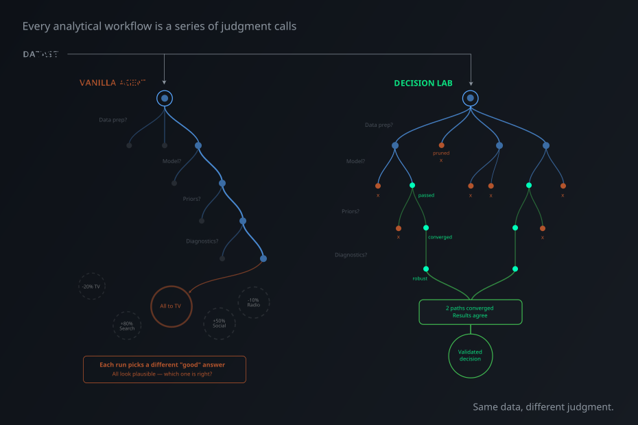{width="64%" fig-align="center"}

<p class="footer-note">Decision Lab runs defensible branches and treats disagreement as signal, not noise.</p>

::: {.notes}
This is the methodological reason for Decision Lab. Many choices are defensible: how much pre-period to use, whether to guard out anticipation days, how to encode seasonality, whether the likelihood should be Gaussian or robust, which placebo dates count as hard checks. A single agent run picks one path and can sound convincing. A Decision Lab run fans out over the defensible paths, prunes failures, and asks whether independent branches converge. If they do not converge, that is not an annoyance; it is information about weak signal or under-specified assumptions.
:::

## Decision Lab in one mental model {.smaller visibility="uncounted"}

<p class="tagline">A decision-pack is a reproducible workflow for analytical judgment.</p>

<div class="pillar-grid">
<div class="pillar"><div class="icon">📦</div><div class="name">Decision-pack</div><div class="desc">Prompt, data contract, skills, tools, and pinned runtime.</div></div>
<div class="pillar"><div class="icon">🌿</div><div class="name">Parallel branches</div><div class="desc">Subagents try different valid model and preprocessing choices.</div></div>
<div class="pillar"><div class="icon">🧪</div><div class="name">Verification stack</div><div class="desc">Execution, diagnostics, predictive checks, sensitivity, review.</div></div>
<div class="pillar"><div class="icon">🗂️</div><div class="name">Audit trail</div><div class="desc">Plans, code, figures, logs, model comparisons, final reports.</div></div>
</div>

<p class="footer-note">Source: <a href="https://www.pymc-labs.com/blog-posts/open-sourcing-decision-lab-scaling-ai-judgment-data-science">PyMC Labs blog, “Agentic Data Science Done Right”</a> (April 1, 2026).</p>

::: {.notes}
Translate the blog's mechanics into our session language. Decision-packs bundle the environment, prompts, and skills. Domain skills constrain the branches. Parallel subagents avoid one stochastic walk through the model space. Frozen environments keep the agent coding against the right package versions. The verification stack decides what can be surfaced. The important output is not just the final answer. It is the trace: what was tried, what failed, why it was pruned, and which branches agreed.
:::

## Homework: build one small decision-pack {.smaller visibility="uncounted"}

<p class="tagline">The deliverable is not “an agent did it.” The deliverable is **a rerunnable spec**.</p>

::: {.columns}
::: {.column width="48%"}
<div class="track">
<div class="track-head">Homework dataset</div>

- Food-delivery banner rollout.
- Difference-in-Differences.
- One treated region, five controls.
- Hidden weak-control trap.
</div>
:::
::: {.column width="48%"}
<div class="track">
<div class="track-head">What to report</div>

- Estimate on conversion.
- Pre-trends / parallel trends.
- Placebo or leave-one-control-out.
- Memo: claim + assumptions.
</div>
:::
:::

::: {.notes}
The concrete homework is now a food-delivery Difference-in-Differences challenge. This is deliberate transfer: new domain, new design, same validation discipline. Students get a daily region panel with one treated region and five controls. The intended trap is a weak control region with bad pre-trends. The pass condition is not "run DiD"; it is "show whether the comparison group deserves trust." Point them to `homework/food-delivery-did-homework.md`.
:::

## Hackathon prompts {.smaller visibility="uncounted"}

<p class="tagline">Small enough for an afternoon; useful enough to show.</p>

<div class="pillar-grid">
<div class="pillar"><div class="icon">🧭</div><div class="name">Decision-pack builder</div><div class="desc">Agent turns a methodology checklist into a draft pack.</div></div>
<div class="pillar"><div class="icon">📉</div><div class="name">Causal pack</div><div class="desc">ITS branches + placebo checks for one intervention dataset.</div></div>
<div class="pillar"><div class="icon">🔎</div><div class="name">Run inspector</div><div class="desc">Reads Decision Lab logs while a long run is still active.</div></div>
<div class="pillar"><div class="icon">✍️</div><div class="name">Content artifact</div><div class="desc">Turns the run trace into a short demo post or report.</div></div>
</div>

<p class="footer-note">Hackathon scoring hook: a visible demo plus a clear write-up beats a large unfinished agent.</p>

::: {.notes}
These prompts come from the hackathon framing. Decision Lab exists, but the interface and pack design are still where people can get stuck. A useful project is an agent that helps create the decision-pack, because the failure mode is not just coding; it is specifying the workflow badly. Another useful project is a run inspector: Decision Lab can be slow, but the logs are rich, so a companion agent can tell you whether it is alive, what branches are running, and which errors were retried. Keep the bar pragmatic: something showable and explainable in a short LinkedIn/blog-style artifact.
:::

# Extras {.section-divider visibility="uncounted"}

<p class="kicker">If there's time</p>

## Evaluate your own skills {.smaller visibility="uncounted"}

<p class="tagline">A bad skill is worse than none — so measure it.</p>

- Run the task **with vs. without** the skill. Compare.

::: {.notes}
The comparison is the deliverable, not "I wrote a skill." For a class-sized version: run one task with and without the skill, score correctness, turns, and whether it ran the validation gate.
:::
